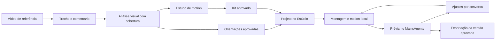

# Briefing de design — Referências de edição e Estúdio com HyperFrames

**Produto:** MainsAgents, aplicativo desktop Electron para Windows. **Data:** 28/10/2026.
**Entrega desta etapa:** fluxo e design navegável para revisão do usuário. Integração, análise real e renderização serão implementadas depois do design aprovado.
**Público:** criador de vídeos sobre notícias, curiosidades e tecnologia, com ou sem câmera, operando por conversa com agentes.

## 1. Pedido para o Claude responsável pelo design

Desenhe duas funcionalidades conectadas dentro do MainsAgents: uma biblioteca de referências que transforma vídeos em conhecimento de edição consultável por diferentes IAs, e um Estúdio no qual o agente produz/edita vídeos usando HyperFrames para motion design. O usuário deve conseguir adicionar referência, marcar o que gosta, revisar a análise, aprovar orientações, pedir um vídeo, assistir à prévia e pedir ajustes dentro do mesmo aplicativo.

Use a identidade visual, navegação e componentes atuais do MainsAgents como ponto de partida. Apresente a jornada completa e os estados de operação, não somente telas bonitas com dados preenchidos. Priorize o conteúdo audiovisual e a comparação visual. Nesta etapa, faça o design/protótipo, sem instalar ferramentas, chamar modelos, renderizar vídeos reais ou alterar dados pessoais. Se o protótipo simular uma operação, identifique a simulação.

O material deve permitir que o usuário aprove a experiência e que um implementador identifique cada ação, estado, entrada e resultado. Há liberdade de composição visual dentro das decisões de produto abaixo. Dimensões, cores finais e detalhes de componentes devem partir do sistema existente; não inventar uma identidade paralela para esse módulo.

## 2. Decisões de produto

1. O usuário trabalha no MainsAgents. HyperFrames executa motion localmente e não aparece como um segundo aplicativo obrigatório.
2. O agente dirige a edição com ferramentas. Pode ser Claude ou outro provedor com as capacidades necessárias. A biblioteca pertence ao workspace, não à sessão nem ao provedor.
3. HyperFrames cria cenas/camadas de motion; ferramentas de mídia fazem montagem, cortes e áudio. O usuário pede o resultado sem precisar escolher ferramentas técnicas.
4. Referência é material de consulta. Análise gera sugestões. Somente orientações aprovadas pelo usuário viram preferências persistentes.
5. Notícias e curiosidades precisam de fontes da pauta. Referências de estilo e fontes factuais são campos diferentes.
6. Gravações preservam o fluxo existente: cortes revisados → acabamento visual → SRT separado, quando solicitado. Visual não muda voz/cortes já aprovados.
7. Cada geração/revisão tem uma versão recuperável. Alterações gerais de estilo não modificam trabalhos anteriores automaticamente.
8. Este briefing propõe capacidades futuras. O aplicativo atual ainda não possui análise visual de referências nem integração HyperFrames completa.

## 3. Organização e navegação

Manter a sidebar global. Propor um destino **Referências de edição** e integrar produção ao **Estúdio** atual. Não criar outro módulo de produção com lista de projetos duplicada. Abertura de um projeto mantém seu conteúdo/workspace, arquivos, conversa e versões existentes.

Dentro de Referências de edição, usar três vistas locais:

- **Referências:** pastas e subpastas contendo vídeos e trechos, notas, análises e busca.
- **Meu estilo:** regras aprovadas, perfis e histórico de alterações.
- **Kit de motion:** estudos animados aprovados e reutilizáveis.

O caminho direto deve ser: adicionar vídeo → estudar trecho → aprovar aprendizado → usar em um projeto. Meu estilo e Kit de motion podem começar vazios e crescer com o uso.

O agente/modelo usado em uma análise aparece nos detalhes da execução. Não transformar Claude, Codex e outros provedores em bibliotecas separadas. Compartilhar entre workspaces é uma ação explícita; um workspace não enxerga referências pessoais de outro por padrão.

## 4. Fluxo A — Do vídeo de referência ao conhecimento

### A1. Biblioteca

Topo com título, busca e ação primária **Adicionar referência**, acompanhada de **Nova pasta**. Navegação local de pastas e subpastas à esquerda; referências da pasta selecionada em cards ou lista na área principal. Cada referência tem thumbnail real, título, duração, tags, data e situação: Sem análise, Em análise, Análise parcial, Pronta para revisar, Aprovada, Arquivada ou Falha. Tags e estado funcionam como filtros complementares.

Cada card informa se há vídeo disponível ou somente link. A imagem não deve parecer uma prévia animada se não houver vídeo. Abrir o card leva a uma página de trabalho; não abrir um popup cobrindo a tela sem contexto.

**Atualização solicitada pelo usuário:** pastas são a organização principal das referências. Cada referência pertence a uma pasta ou fica em **Sem pasta**; tags permitem classificar o mesmo item por vários assuntos sem duplicar o vídeo. Oferecer **Todas as referências**, **Sem pasta** e as pastas criadas pelo usuário. Exemplos ilustrativos, sem criação obrigatória: Motion design → Tipografia / Diagramas / Transições; Edição → Notícias / Curiosidades / Tech; Áudio e ritmo. Pastas organizam o material; perfis de Meu estilo continuam representando orientações aprovadas.

Criar, renomear e mover pastas/subpastas; expandir/recolher a árvore; mover uma ou várias referências por ação **Mover para…**, com arrastar e soltar como alternativa. Usar breadcrumb para mostrar o caminho atual. O item tem identidade própria: movê-lo preserva vídeo, trechos, comentários, análises, aprovações e ligações com estudos/projetos. Não criar cópia ao mover nem reanalisar automaticamente.

Ao adicionar um vídeo dentro de uma pasta, sugerir essa pasta como destino. No topo da biblioteca, pedir/oferecer destino com opção Sem pasta. Busca informa o escopo: **Nesta pasta**, com inclusão explícita de subpastas, ou **Todas as referências**; resultados globais exibem o caminho. Contagens da pasta devem indicar se incluem subpastas. Não confundir filtro de estado com itens desaparecidos ou removidos.

**Excluir pasta** remove somente a organização: mostrar previamente que suas referências e as referências das subpastas ficarão em Sem pasta, preservando arquivos e conhecimento. Oferecer confirmação com descrição do efeito e opção de desfazer a reorganização. Exclusão/arquivamento de uma referência é uma ação separada; nenhum comando de pasta apaga vídeos do computador.

Vazio: explicar em uma frase o objetivo e oferecer **Adicionar meu primeiro vídeo**. Com referências, oferecer **Continuar revisão** quando houver resultados pendentes.

### A2. Adicionar referência

Um formulário curto, em painel ou página: arrastar arquivo ou **Escolher vídeo**; título sugerido pelo nome do arquivo, editável; **Pasta de destino** com caminho atual e Sem pasta; comentário opcional **O que você quer aproveitar?**; tags opcionais. Salvar e começar a análise são ações distintas.

Importar organiza uma cópia gerenciada pelo app sem alterar o original, mostra progresso real e cria uma versão da referência. Não duplicar o mesmo arquivo silenciosamente. Arquivo grande pode preparar proxy/miniaturas em segundo plano; o usuário pode navegar para outra área.

**Adicionar link** é uma entrada secundária. Um link salvo não significa conteúdo recebido/analisado. Exibir “Link salvo — adicione o vídeo para análise visual” quando não houver material acessível. Não desenhar importação automática de YouTube/Instagram como se já existisse.

Erro deve dizer o motivo e o próximo passo: arquivo indisponível, formato não aceito, espaço insuficiente, preparação falhou. Referência já cadastrada oferece abrir a existente ou adicionar nova versão, sem sobrescrever a anterior.

### A3. Página de estudo da referência

Composição regular sugerida:

```text
Título da referência                         [Analisar trecho] [Mais]
-------------------------------------------------------------------
Vídeo original + controles             | Notas e análise
                                      | [Meu comentário]
                                      | [Análise da IA]
--------------------------------------| [Aprendizados]
Linha do tempo, cenas e intervalo      | [Conversa desta referência]
Miniaturas / faixa de cobertura        |
```

Player prioritário, painéis redimensionáveis/recolhíveis. O usuário deve poder assistir sem a análise cobrir a imagem. Título/workspace e voltar para biblioteca ficam visíveis. Comportamento compacto definido na seção de responsividade.

Controles: reproduzir/pausar, volume, velocidade, tempo atual/duração, anterior/próximo quadro, selecionar início/fim de trecho e limpar seleção. Mostrar indicador do quadro quando disponível. Próximo quadro usa decodificação/tempos reais, inclusive em vídeos com fps variável; o design não promete precisão inexistente.

Linha do tempo com trechos nomeados e miniaturas. Clicar em um trecho posiciona o player; arrastar define seleção. O usuário pode marcar “Quero aproveitar” e “Quero evitar”, com texto e tempos. Ambos têm rótulos/ícones, não só cores.

Campo de conversa aceita pedidos como “Analise como este título entra”, “Compare o ritmo destes dois trechos” e “Quero o movimento, mas não essa fonte”. Notas, marcações e resultados permanecem salvos ao sair da página.

### A4. Iniciar análise

Selecionar vídeo inteiro ou intervalo e escolher o agente/modelo antes de iniciar. Mostrar o que será examinado, se imagens serão enviadas ao provedor escolhido e a disponibilidade dessa capacidade. Um modelo sem visão pode consultar conhecimento em texto; não pode executar uma análise visual apresentada como se enxergasse frames.

Duas ações compreensíveis:

- **Analisar estrutura:** leitura temporal por cenas/janelas, com sequência de imagens, transcrição e medições quando disponíveis. O resultado identifica cobertura e amostragem.
- **Estudar movimento deste trecho:** leitura densa da seleção para acompanhar mudanças de posição, escala, tipografia, transições, entradas/saídas e relação com som. Dividir em partes quando necessário.

**Contrato de “quadro a quadro”:** o usuário consegue navegar pelos quadros e solicitar estudo detalhado. A leitura da IA acontece em sequências e janelas, com quantidade/intervalos registrados. Não chamar amostragem de “todos os quadros analisados”. Se for oferecida varredura de todos os quadros de um trecho, deve exigir processamento real de cada quadro/janela e mostrar contagem/pendências. Vídeos longos não são enviados inteiros sem limites invisíveis.

Se houver limites de duração/capacidade, mostrá-los antes de executar. Não inventar números de créditos, preço ou tempo restante. O usuário pode reduzir o intervalo ou dividir a análise. Troca de modelo não troca silenciosamente uma tarefa em andamento.

Durante a operação, mostrar fase atual: Preparando vídeo → Separando cenas/quadros → Analisando trecho X → Organizando aprendizados. Usar percentual apenas nas fases com total mensurável. Permitir cancelar e continuar usando o app. A execução conserva resultados concluídos como parciais; nova tentativa é explícita.

### A5. Resultado com evidência

Apresentar a análise ao lado do trecho que a sustenta. Cada observação pode abrir seus tempos e frames. Separar:

| Campo | Exemplo ilustrativo |
| --- | --- |
| O que foi observado | “O título cresce e desacelera antes de parar.” |
| Onde aconteceu | Trecho 00:08–00:10, com sequência de imagens |
| Como adaptar | “Usar entrada curta para apresentar um conceito.” |
| Seu comentário | “Quero o movimento mais discreto.” |
| Limite da análise | “Curva exata não determinada.” |

Detalhes podem incluir cores aproximadas, hierarquia, composição, ritmo e relação audiovisual. Não afirmar nome de fonte, curva precisa ou causa de um efeito sem evidência. Estimativa visual deve ser identificada.

Cobertura fica acessível: intervalos examinados, não examinados e com falha. Exibir o modelo e data da análise nos detalhes, sem transformar isso no foco da tela.

Ações por aprendizado: **Editar orientação**, **Aprovar para meu estilo**, **Guardar apenas nesta referência**, **Descartar sugestão**. A aprovação pode incluir várias sugestões, mas oferece revisão do texto final. “Análise concluída” e “Estilo aprovado” são estados diferentes.

### A6. Meu estilo

Página de orientações em linguagem comum, com origem e perfil. Exemplo: “Na explicação de um processo, revelar um passo por vez, sincronizado com a fala.”

Agrupamentos simples: ritmo/cortes; visual/movimento; textos; som; o que evitar. Perfis opcionais: notícias, curiosidades, tutorial tech. Não obrigar a configurar tudo antes de usar uma referência.

Editar cria versão do manual. Conflitos visíveis: “Entrada rápida” versus “Entrada lenta” podem valer para perfis diferentes; pedir escolha/escopo, sem o app decidir silenciosamente. Regra pode ser desativada e reativada. Cada regra pode voltar à referência de origem.

O usuário não precisa de Obsidian nem de uma sessão permanente para manter o conhecimento. Markdown/Obsidian pode virar importação/exportação futura; o desenho inicial prioriza a gestão dentro do app.

### A7. Kit de motion — ponte com HyperFrames

Da referência, ação **Criar estudo de motion**. O usuário escolhe trecho, o que manter/adaptar, texto/assets e formato. O agente usa o HyperFrames local para criar uma amostra curta; o resultado mantém ligação com a referência sem copiar obrigatoriamente a peça inteira.

Revisão com referência/estudo lado a lado, controles com tempos próprios e replay do intervalo. Não prometer sincronização entre vídeos de durações diferentes sem alinhamento. Permitir “Mais lento”, “Menos movimento” e comentário livre.

Depois de aprovar: **Salvar no kit de motion**. Card com nome, finalidade, prévia, perfil e **Usar em um projeto**. Campos editáveis podem incluir texto, cor, valor ou imagem. Alterações estruturais/formato são novas composições/revisões, não simples campos universais.

O kit pode ter título, callout, lista, comparação, diagrama ou transição. O primeiro uso pode ser um estudo próprio; não depender de catálogo completo. Sucesso significa estudo aprovado e arquivo validado, não apenas uma resposta textual do agente.

## 5. Fluxo B — Estúdio e produção no MainsAgents

### B1. Criar ou abrir projeto

Integrar a **Novo vídeo** no Estúdio existente. Duas entradas:

- **Editar gravação:** importar/selecionar câmera, tela ou material original e definir a intenção.
- **Criar vídeo:** começar por ideia, roteiro, narração, documentos, dados ou fontes.

No segundo caminho, escolhas de apresentação: Com apresentador, Narrado ou Motion completo, com resumo do que é necessário em cada opção. Áudio pode ser fornecido pelo usuário ou gerado somente quando houver integração e pedido apropriados; não simular uma voz conectada inexistente.

Briefing inicial curto: objetivo/tema, formato, duração desejada e materiais. Campos de fontes factuais separados das referências de estilo. Etapas adicionais aparecem conforme a necessidade do projeto.

### B2. Selecionar conhecimento

Bloco **Estilo e referências**: selecionar perfil, referências e itens do kit. Navegar pelas mesmas pastas da biblioteca e buscar sem duplicar a organização. Selecionar uma pasta permite escolher referências elegíveis daquele conjunto; mostrar os itens efetivamente selecionados e se subpastas estão incluídas. A seleção fica registrada como lista de itens/versões: novos arquivos adicionados à pasta não entram automaticamente num projeto já criado. Oferecer sugestões com motivo (“diagrama para explicar processo”), mas deixar ver/remover o que será usado. Conhecimento aprovado pode ser padrão; referências novas ainda não aprovadas podem valer apenas nessa peça.

Mostrar seleção compacta e editável. Não despejar todas as análises no chat. Cada versão de produção registra o manual e materiais usados; alterações posteriores na biblioteca não mudam uma versão já renderizada.

### B3. Preparar roteiro e cenas

Em gravações, o corte base é revisado antes do visual. Em vídeos novos, apresentar roteiro e lista/storyboard de cenas. Cada cena informa tempo/faixa planejada, fala ou mensagem, material e intenção visual. Tipos: vídeo/foto real, captura de tela, texto de apoio, diagrama/motion.

Claude propõe onde o motion ajuda. O usuário pode corrigir por conversa ou pela seleção da cena. Uma edição simples pode ir à prévia depois de briefing e corte aprovados; a escolha de revisar storyboard não deve gerar um ritual obrigatório em cada ajuste pequeno.

Notícias: fontes consultáveis junto aos fatos; trechos não verificados sinalizados para revisão. Não colocar selo automático de “verdadeiro”. Imagem ilustrativa/reconstituição deve ser identificável no planejamento e na entrega quando necessário. Notícias atuais não são aprendidas como regra permanente de estilo.

### B4. Tela principal de produção

Composição regular sugerida:

```text
Projeto / conteúdo                 Versão 3 · Prévia pronta   [Exportar]
------------------------------------------------------------------------
Cenas / materiais       | Player da prévia                  | Conversa
1. Abertura             |                                   | do projeto
2. Fonte + imagem       |                                   |
3. Diagrama             |                                   | Contexto:
4. Fechamento           |                                   | Estilo + refs
------------------------|-----------------------------------|
                        | Timeline de cenas + marcações      | [Pedir ajuste]
```

Uma prévia grande, uma conversa do projeto e lista de cenas devem resolver a maior parte da operação. Recursos de inspeção revelados sob demanda. Não desenhar um editor profissional completo com dezenas de pistas e keyframes como pré-requisito para a primeira entrega.

Selecionar uma cena localiza o tempo correspondente no player e oferece **Pedir ajuste nesta cena**. Selecionar intervalo no player preenche o contexto da mensagem sem exigir que o usuário digite segundos.

Composer mostra alvo antes de enviar: projeto todo, cena selecionada ou intervalo. Exemplos: “Diminua este título”, “Troque por um diagrama”, “Mantenha a voz e reduza o movimento”. A alteração cria uma revisão e conserva a versão anterior.

O usuário pode abrir versões em comparação. Uma prévia antiga continua reproduzível enquanto nova revisão é gerada e deve ser rotulada como versão anterior. Não fazer a mensagem da versão nova aparecer como se o player antigo já estivesse atualizado.

### B5. HyperFrames dentro da experiência

HyperFrames aparece discretamente no estado do motor/detalhes da cena; operações normais usam ações “Gerar estudo”, “Gerar prévia”, “Pedir ajuste” e “Exportar”. Sem terminal, nomes de pacotes, parâmetros técnicos ou troca obrigatória de aplicativo na jornada principal.

Primeira entrega: motor local executado pelo host e prévia reproduzível dentro do MainsAgents. Edição ocorre por conversa. A documentação HyperFrames oferece SDK para edição/seleção interativa, mas arrastar camadas, propriedades e keyframes embutidos ficam como evolução explicitamente separada.

Estados do motor: Não configurado, Verificando, Preparando, Pronto, Incompatível/Erro. Mostrar no ponto em que ele é necessário e em configurações. **Preparar HyperFrames** inicia um fluxo com progresso e descrição do que está sendo instalado/configurado; sem bloqueio de toda a biblioteca por motor ausente. Aplicativo desktop instalado e motor compatível são estados diferentes.

Render em progresso: nome da operação, projeto/revisão, fase, contagem real quando disponível e Cancelar. App segue navegável. Falha oferece **Ver detalhes** e **Tentar novamente**; não reenvia automaticamente nem troca de ferramenta/provedor silenciosamente.

Uma edição no desktop HyperFrames feita fora do app pode gerar conflito de versão; guardar o trabalho e oferecer reabrir/conciliar, sem sobrescrever. A primeira versão pode tratar isso como importar nova versão em vez de prometer sincronização bidirecional instantânea.

### B6. Revisão e exportação

Aprovação é da versão exibida. Se a prévia não corresponde à revisão atual, indicar isso e oferecer gerar prévia. Arquivo só aparece como entregue depois de existir e ser validado.

Entrega: MP4, acesso ao projeto editável e SRT separado quando escolhido. Cada arquivo tem nome, versão, duração/formato e Abrir/Mostrar na pasta. Local de saída é visível. Não incluir publicação em redes sociais nesta entrega.

Após uma correção, oferecer ação discreta **Salvar como preferência**, com escopo: Somente este projeto (padrão), Meu estilo ou Item do kit. Conversa não transforma automaticamente um comentário casual em regra global.

## 6. Conexões entre os dois fluxos



- Da referência: **Usar neste projeto** e **Criar estudo de motion**.
- Do kit: **Usar em um projeto** e **Ver referência de origem**.
- Do projeto: **Ver referências usadas**, **Adicionar referência** e **Salvar preferência**.
- Aprovar uma orientação não renderiza automaticamente um vídeo; salvar um estudo no kit não altera projetos existentes.

## 7. Estados que o design precisa mostrar

| Situação | Comportamento e ação |
| --- | --- |
| Biblioteca vazia | Explicação curta + Adicionar meu primeiro vídeo |
| Pasta vazia | Nome/caminho e ações Adicionar referência ou Nova subpasta |
| Referência movida | Feedback com destino e Desfazer; estudo/análise preservados |
| Busca sem resultado | Mostrar escopo/filtros e oferecer buscar em todas as referências |
| Excluir pasta com conteúdo | Explicar movimentação para Sem pasta, sem excluir arquivos |
| Preparando arquivo | Progresso local, voltar/navegar sem perder tarefa |
| Somente link | Informar ausência de vídeo analisável |
| Referência pronta, sem IA conectada | Player/notas funcionam; Conectar agente para analisar |
| Modelo sem visão | Explicar a limitação e escolher modelo compatível |
| Análise em andamento | Etapa/trecho, Cancelar, resultados parciais separados |
| Cota do provedor ou falha de rede | Preservar material; reconexão/nova tentativa explícita |
| Análise parcial | Cobertura e pendências; Estudar trecho restante |
| Aprendizado pendente | Editar/aprovar/descartar sem perder a referência |
| Referência atualizada | Resultados antigos vinculados à versão anterior |
| Motor não preparado | Preparar no próprio app; biblioteca segue disponível |
| Prévia nova em processamento | Versão anterior utilizável e identificada |
| Render falhou/cancelou | Histórico preservado; nova tentativa sem duplicação |
| Projeto/arquivo mudou externamente | Mostrar conflito e opções para preservar ambas as versões |
| Exportação pronta | Arquivos reais, versão, Abrir e Mostrar na pasta |
| Reinício do app durante operação | Resultado anterior preservado; interrompida não vira concluída nem é reenviada sem ação |

## 8. Responsividade, teclado e acessibilidade

Desenhar desktop regular em 1440×900 e 1280×800, e compacto em 1024×768. São alvos de revisão, não limites arbitrários de implementação. Painéis recolhem sem esconder a ação principal nem criar rolagem horizontal de página. A árvore de pastas é recolhível e navegável por teclado, com alternativa acessível a arrastar e soltar. Na largura compacta, usar seletor de pasta + breadcrumb; no estudo/produção, manter player e alternar abas locais para Cenas, Análise e Conversa; conservar seleção e tempo ao alternar.

Foco visível, rótulos para ícones, ações acessíveis por teclado, contraste medido nos dois temas e conteúdo legível com zoom de 200%. Reutilizar escala tipográfica e tokens do app; corpo proposto 14–16 px, legendas auxiliares pelo menos 12 px, sujeito à validação no sistema existente. Controles frequentes com área confortável de 32–36 px como escolha de projeto, sem alegar requisito Apple em pixels CSS.

Player focado: Espaço reproduz/pausa, setas avançam/voltam conforme função documentada, botões explícitos anterior/próximo quadro disponíveis. Atalhos não disparam ao escrever em chat/notas. Esc encerra seleção/menu e retorna foco; não cancela silenciosamente análise/render. Enter envia apenas conforme preferência já adotada pelo app; Shift+Enter insere linha quando aplicável.

Estados usam texto + ícone, não só cor. Thumbnails sem autoplay. Reduzir movimento da interface não altera o conteúdo do vídeo. Contraste/segurança visual do vídeo são avaliados separadamente da acessibilidade dos controles.

Preferir páginas e painéis para trabalho prolongado. Dialogs curtos para escolha simples/configuração pontual. Evitar popup gigante ao adicionar referência, analisar ou pedir ajuste. Erros próximos da ação correspondente, com próximo passo; sem alertas repetidos.

## 9. Componentes e entregáveis para o designer

Componentes: árvore de pastas, breadcrumb, seletor de pasta/destino e ação Mover para, card de referência, card de item do kit, player com seleção/quadro a quadro, linha de tempo de trechos/cenas, faixa de cobertura da análise, observação com evidência, orientação aprovável, seletor de estilo/referências, tarefa em progresso, seletor/comparação de versão, mensagem de entrega e composer com alvo do ajuste.

Entregar telas/estados:

1. Biblioteca vazia e preenchida, árvore de pastas/subpastas, pasta vazia, criar/renomear/mover e excluir pasta preservando referências.
2. Adicionar vídeo e preparação em andamento.
3. Referência aberta, seleção de trecho e comentário.
4. Configuração de análise/modelo e análise em andamento.
5. Análise pronta/parcial, evidências e aprovação.
6. Meu estilo com regras, perfil e origem.
7. Estudo de motion com comparação e salvamento no kit.
8. Kit com ação Usar em um projeto.
9. Novo vídeo com duas entradas e seleção de referências.
10. Roteiro/cenas de vídeo novo e revisão de corte de gravação.
11. Produção com player, cenas, conversa e alvo selecionado.
12. Geração/revisão, versão anterior disponível e erro recuperável.
13. Aprovação e entrega de arquivos.
14. Motor não preparado/configuração e estado pronto.

Não precisam ser 14 páginas independentes; várias são estados da mesma tela. Mostrar as jornadas principais clicáveis com dados de exemplo consistentes: uma referência de diagrama animado, uma orientação aprovada, um estudo aprovado e um vídeo tech que utiliza esse material. Usar conteúdo ilustrativo identificado, sem inventar notícia real ou fonte verificada.

Escolher uma tela central de cada fluxo para tema claro/escuro e versão compacta. Anotar estados, ações, navegação e comportamento dos painéis. Distinguir interação disponível no primeiro incremento e evolução futura. O ponto visual memorável deve ser a ligação entre trecho original, observação e resultado produzido, com a interface ao redor discreta; esta é uma escolha de produto, não uma norma de plataforma.

## 10. Ordem de implementação posterior ao design

1. Fundação local: disponibilidade/versão do motor, projeto isolado e estudo sintético renderizado e reproduzido dentro do app.
2. Importação e estudo de referências: vídeo/trechos/notas, frames e capacidades multimodais por provedor, cobertura e aprovação de conhecimento.
3. Meu estilo e primeiro kit: consulta por projeto, estudo HyperFrames e reaproveitamento.
4. Estúdio integrado: acabamento de gravações, entrada de motion completo, prévia e ajustes por conversa, exportação/versionamento.
5. Expandir pesquisa/roteiros/áudio conforme integrações reais; edição visual direta via SDK e sincronização externa em incrementos posteriores.

Projeto novo a partir de roteiro e produção narrada são parte da visão de produto. O desenho deve mostrar sua entrada e dependências, sem tratar voz sintética/pesquisa automática como serviços já disponíveis. A primeira implementação pode começar com roteiro e voz fornecidos pelo criador.

Critério de sucesso: adicionar um vídeo, entender um trecho com evidência real, aprovar uma orientação, produzir um estudo e usá-lo em um vídeo, revisar/exportar tudo dentro do MainsAgents. Nenhuma dessas etapas deve depender de manter uma conversa antiga aberta ou de abrir o HyperFrames desktop.

## 11. Base técnica e referências do briefing

Código atual: `src/features/content/inspiration.ts`, `editor-inspiration-analysis.mjs`, `editor-guidance.mjs`, `editor-host.mjs`, `editor-authoring.mjs`, `claude-code-bridge.mjs`, `edit-stages.mjs` e `src/components/production/EditStages.tsx`. Referências atuais têm isolamento por workspace e ligação com arquivos; análise atual é textual/temporal. Esses limites devem orientar a implementação, sem aparecer como termos técnicos no fluxo do usuário.

HyperFrames: [render local e formatos](https://hyperframes.heygen.com/guides/rendering), [integração com agentes e artefatos](https://hyperframes.heygen.com/developers/harness-tool-context), [preview/SDK](https://hyperframes.heygen.com/sdk/guides/canvas-integration), [estilo, variáveis e storyboard](https://hyperframes.heygen.com/prompting/design-systems). O SDK viabiliza controles incorporados, mas não equivale a encaixar a janela inteira do desktop dentro do app.

Princípios da skill `apple-design`, adaptados ao Electron/Windows, sem impor convenções visuais macOS: `generative-ai.md › Transparency` — “Set clear expectations about what your AI-powered feature can and can’t do”; `loading.md › Best practices` — “Let people do other things”; `progress-indicators.md › Best practices` — “Be as accurate as possible” e “let people halt processing”; `accessibility.md › Best practices` — contraste; `layout.md › Visual hierarchy`, `typography.md › Ensuring legibility`, `color.md › Inclusive color` e `designing-for-macos.md › Best practices` — hierarquia, teclado e espaço de trabalho desktop. Esses arquivos foram consultados sob `.agents/skills/apple-design/references/hig/`. A arquitetura de navegação, os nomes de telas e a divisão do escopo são decisões propostas neste briefing.
